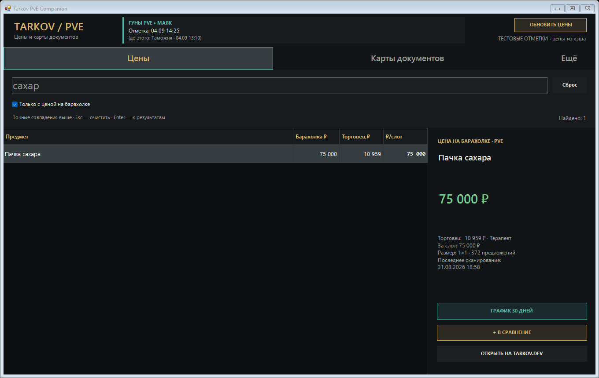
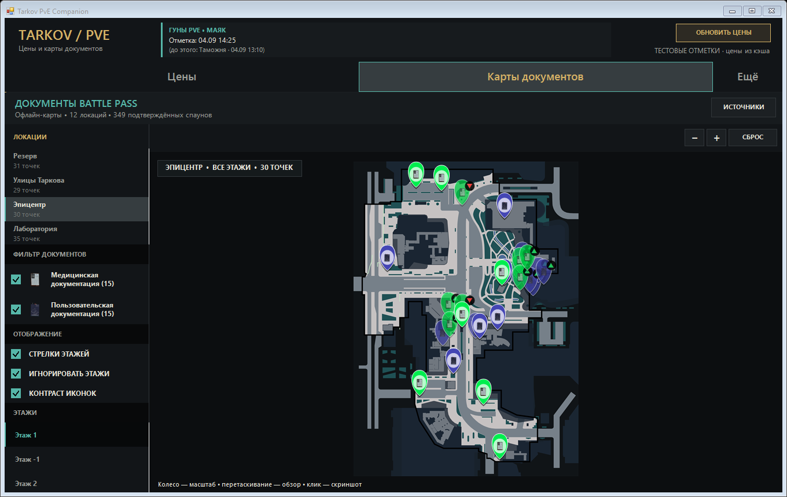

# Tarkov PvE Companion

Windows-помощник для Escape from Tarkov PvE: цены предметов, сравнение с торговцами, цена за слот, поиск с обработкой опечаток, карты документов и сообщения сообщества о Goons. Есть классический и облегчённый интерфейсы.

## Версия 4.1

Подробное описание функций и ограничений — в [русском руководстве](README_RU.md). Для сборки используется `build.ps1`; исходники — `Program.cs` и `BattlePass.cs`. Пакет карт `BattlePassAssets.zip` исключён из этой подготовленной копии до проверки условий распространения, поэтому сборка здесь пока неполная.

Цены на снимках исторические, а тестовые отметки Goons не показывают их положение в реальном рейде.

## Лицензии

Файл лицензии для собственного кода не найден. У карт и игровых материалов могут быть отдельные условия; их следует установить до публичного релиза.
